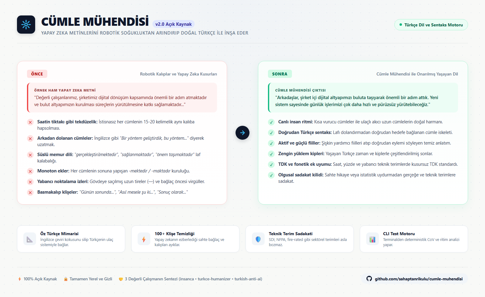

# Cümle Mühendisi

<p align="center">
  
</p>

Cümle Mühendisi; Türkçe metinlerdeki yapay zeka izlerini, gereksiz laf kalabalığını, fazla uzun cümleleri, tekrar eden sıradanlaşmış kalıpları, makyajlı plaza dilini ve gereksiz noktalama işaretlerini temizleyen açık kaynaklı bir dil mimarisi ve düzeltme motorudur.

Piyasadaki birçok araç sadece kelimeleri eşanlamlılarıyla değiştirip işin içinden çıkar. Cümle Mühendisi ise kelimelerle vakit kaybetmek yerine doğrudan cümlenin çatısına odaklanır. Türkçenin kendi mantığına uymayan yapıları düzeltir, yapay zekanın ezberlediği kalıpları ayıklar ve yazıyı yaşayan bir insanın kaleminden çıkmış gibi akıcı hale getirir.

---

## Yapay Zekanın Türkçe Yazarken Düştüğü 5 Büyük Tuzak

ChatGPT, Claude veya benzeri bir yapay zekaya Türkçe yazı yazdırdığınızda ortaya çıkan metin genellikle dil bilgisi açısından kusursuz görünür. Noktası virgülü yerindedir, yazım hatası yoktur. Buna rağmen metni okurken içinize bir yapaylık hissi oturur. Karşınızda sanki yaşayan biri değil de kravatını sonuna kadar sıkmış bir robot konuşuyordur.

Cümle Mühendisi, bu yapaylığa yol açan temel kusurları şöyle teşhis edip çözer:

### 1. Saatin Tiktakı Gibi Hep Aynı Boyda Cümleler Kurması
Yapay zeka yazı yazarken cümle uzunluklarını neredeyse hiç değiştirmez. İstisnasız her cümle 15 ile 20 kelime arasında bir uzunluğa sahiptir. Bir süre sonra bu tekdüzelik okuru yorar ve uykusunu getirir. 

Oysa gerçek bir insan böyle konuşmaz ve yazmaz. Kimi zaman lafı uzatmadan iki üç kelimelik kısa ve net bir cümle kurarız: *"Olay bu kadar net."* Kimi zaman da birbirini izleyen eylemleri birbirine bağlayıp uzun uzun anlatırız. Cümle Mühendisi bu robotik ritmi bozar; yazıya inişler, çıkışlar ve nefes payları ekler.

### 2. İngilizce Cümle Mantığını Türkçeye Zorla Giydirmesi
Yapay zeka modellerinin ana dili İngilizcedir. İngilizcede bir fikir anlatılırken önce ana kelime söylenir, sonra arkasına ek bir açıklama takılır. Yapay zeka bunu Türkçeye çevirirken lafı hep arkasından dolandırır:
* **Yapay Zeka:** *"Yeni bir yazılım geliştirdik, bu yazılım sayesinde üretimdeki hatalar sıfıra iniyor."*
* **İnsan Türkçesi:** *"Üretimdeki hataları sıfıra indiren yeni bir yazılım geliştirdik."*

İlki lafı uzatıp çeviri kokarken, ikincisi doğrudan ve temiz bir Türkçeyle söyler. Cümle Mühendisi arkadan dolanan tüm cümleleri Türkçenin öz mantığına kavuşturur.

### 3. Süslü Memur Dili ve Boş Laf Kalabalığı
Yapay zeka hiçbir zaman *"toplantı yaptık"* veya *"sistemi hızlandırdık"* demez. Mutlaka *"toplantı yapılması sağlandı"*, *"hız artışı temin edildi"* ya da *"kilit vazife üstleniyor"* gibi dolambaçlı kalıplara sığınır. Çok kelime kullanınca daha bilgili görüneceğini zanneder. Cümle Mühendisi bu tür boş süslemeleri ve bürokratik laf kalabalığını doğrudan budar; cümlenin içindeki asıl eylemi ortaya çıkarır.

### 4. Sonu Gelmeyen "-mektedir / -maktadır" Kuruluğu
Bir yazıyı robotun yazdığını anlamanın en kestirme yolu cümle sonlarına bakmaktır. *"Yapılmaktadır, hedeflenmektedir, öngörülmektedir..."* Arka arkaya sıralanan bu ekler metni canından bezdirir. Cümle Mühendisi bu ekleri temizler, yüklemleri yaşayan Türkçe kiplerle zenginleştirir.

### 5. Türkçede Yeri Olmayan Noktalama İşaretleri ve Alışkanlıklar
İngilizce yazılarda sıkça geçen upuzun tireler, yersiz noktalı virgüller ve "ama" bağlacının önüne konan gereksiz virgüller yapay zekanın en belirgin izleridir. Türkçede bağlaçlardan önce veya sonra virgül konmaz. Cümle Mühendisi bu tür yabancı alışkanlıkları temizler ve Türk Dil Kurumu standartlarına tam uyum sağlar.

---

## Somut Örneklerle Değişim

### Örnek 1: Şirket Duyurusu ve E-posta

* **Yapay Zeka Hali:**  
  *"Değerli çalışanlarımız, şirketimiz dijital dönüşüm kapsamında önemli bir adım atmaktadır. Yeni kurulan bulut altyapımız, çalışanlarımızın iş süreçlerini daha verimli bir şekilde yürütmelerine katkıda bulunacaktır. Sürecin başarılı bir şekilde bitirilmesi kilit ehemmiyete haizdir."*

* **Cümle Mühendisi ile Onarılmış Hali:**  
  *"Arkadaşlar, şirket içi dijital altyapımızı buluta taşıyarak önemli bir adım attık. Yeni sistem sayesinde günlük işlerimizi çok daha hızlı ve pürüzsüz yürütebileceğiz. Hepimizin yeni sisteme zamanında uyum sağlaması işlerin aksamaması açısından şart."*

### Örnek 2: Blog ve Düşünce Yazısı

* **Yapay Zeka Hali:**  
  *"Günün sonunda, başarılı olmak sadece çok çalışmaktan geçmemektedir. Doğru stratejiyi belirlemek ve bu stratejiyi kararlılıkla uygulamak da başarı yolunda vazgeçilmez bir unsurdur. Belki de asıl mesele, ne zaman duracağını bilmektir."*

* **Cümle Mühendisi ile Onarılmış Hali:**  
  *"Başarı sadece körü körüne çok çalışmakla gelmiyor. Nereye gittiğini bilmek ve belirlediğin yolda sabırla yürümek işin asıl zor kısmı. Çoğu zaman ne yapacağını bilmek kadar ne zaman durup soluklanacağını kestirebilmek de fark yaratıyor."*

### Detaylı Testler ve Karşılaştırmalı Örnekler Listesi

Cümle Mühendisi'nin ele aldığı 6 temel işlevin (çeviri mantığını kırma, tekdüze ritmi canlandırma, kof memur dilini budama, monoton ekleri temizleme, yabancı noktalama işaretlerini ayıklama ve teknik terimleri koruma) öncesi/sonrası ve test analizleri için:

👉 **[Örnekler ve Test Raporları Kılavuzu (references/ornekler-ve-testler.md)](references/ornekler-ve-testler.md)** belgesini inceleyebilirsiniz.

---

## Önemli Prensipler

### 1. Yalan Bilgi ve Uydurma Hikaye Yasaktır (Olgusal Sadakat)
Piyasadaki bazı metin insanileştirme araçları metni doğallaştıracağım derken kaynakta olmayan sahte hikayeler, uydurma tarihler ve hayali istatistikler ekler. Cümle Mühendisi'nde bu kesinlikle yasaktır. Metindeki gerçek bilgi, teknik veriler ve rakamlar neyse olduğu gibi korunur. Gerçeğe tek bir yalan katılmaz.

### 2. Sektörel ve Teknik Terimlere Dokunulmaz
İhracat, kalite kontrol, mühendislik veya yazılım alanındaki teknik standartlar (SDI, NFPA, fire-rated, hollow metal, cache, SQL, endpoint vb.) zoraki Türkçeleştirilip bozulmaz. Terimlerin aldığı ekler yazılışa göre değil, Türkçedeki okunuşuna göre gelir (`cache'i`, `SQL'i`, `GitHub'da` gibi).

---

## Nasıl Kullanılır?

Cümle Mühendisi üç farklı senaryoda çalışacak şekilde tasarlanmıştır:

1. **Onarım Modu:** Elinizdeki hazır bir yapay zeka metnini ya da çeviriyi alır. Teknik doğruluğu ve ana fikri bozmadan baştan aşağı doğal Türkçeye çevirir.
2. **Yazma Modu:** Sıfırdan bir konu hakkında yazı yazarken robot kalıplarına hiç girmeden doğrudan insan zihniyle metin üretir.
3. **Denetim Modu:** Metne dokunmadan içindeki yapay zeka tuzaklarını, gereksiz ekleri ve ritim kusurlarını madde madde raporlar.

### Terminalden Otomatik Denetim Aracı

Repoda yer alan analiz betiği sayesinde herhangi bir metin dosyasını saniyeler içinde tarayabilirsiniz:

```bash
python scripts/detect_tr_ai.py dosyaniz.txt
```

Bu araç metninizdeki cümle ritmini, tekrarlanan ekleri ve gizlenmiş yapay zeka izlerini hızlıca ekrana getirir.

---

## Teşekkür ve Atıf

Bu çalışma bir gecede ve tek başına ortaya çıkmadı. Arkasında Türkçe dil yapısı ve yapay zeka metin kalıpları üzerine kafa yoran üç değerli açık kaynak çalışmanın emeği ve birikimi yatıyor. Onların ortaya koyduğu araştırmalar, kalıp listeleri ve yapısal yaklaşımlar olmasaydı bu sentezi kurmak çok daha zor olurdu.

Kendilerine içtenlikle teşekkür ediyorum:

* **Tahir Yıldız ([tahiryildiz/insanca](https://github.com/tahiryildiz/insanca)):** Çıkardığı 48 içerik ve üslup kalıbı, 25 ritim kuralı ve dedektör analizleriyle bu projenin en sağlam temel taşını oluşturdu.
* **Büşra Beggi ([bushrabeg/turkce-humanizer](https://github.com/bushrabeg/turkce-humanizer)):** Geliştirdiği iki fazlı temizlik mimarisi, mutlak yasaklar listesi ve yazar profili yaklaşımıyla sistemin çerçevesini zenginleştirdi.
* **Yüce Zerey ([yucezerey/turkish-anti-ai-skill](https://github.com/yucezerey/turkish-anti-ai-skill)):** Cümle mimarisinin doğal Türkçe sentaksa kavuşturulması, TDK tipografi kuralları, fonetik ek standartları ve terminal denetim aracıyla projenin analiz omurgasını sağladı.

---

## Lisans

Bu proje MIT Lisansı altında sunulur. Ayrıntılar için `LICENSE` dosyasına bakabilirsiniz.
